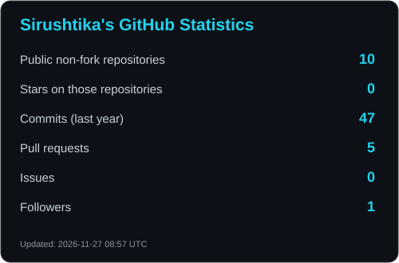
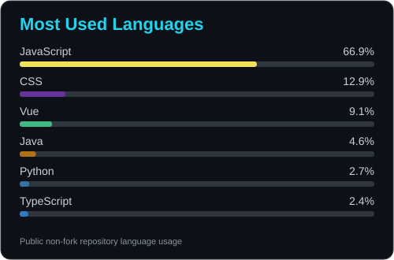
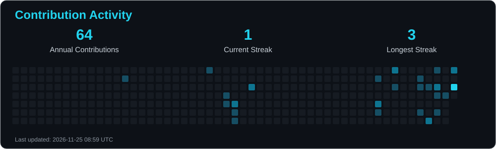

<!-- ================= HEADER BANNER ================= -->

<p align="center">
  
</p>

<h3 align="center">

  Computer Engineering | AI & ML | Software Development

</h3>

<!-- ================= ANIMATED TYPING ================= -->

<p align="center">
  
</p>

<!-- ================= SOCIAL BADGES ================= -->

<p align="center">
  <a href="https://github.com/sirushtika4">
    
  </a>
  
  <a href="https://www.linkedin.com/in/sirushtika-pojarajah-ab8401384">
  
</a>
<a href="mailto:sirushtika4@gmail.com">
  
</a>
</p>

<!-- ================= NAVIGATION ================= -->

<p align="center">
  <a href="#about-me">About</a> •
  <a href="#current-focus">Current Focus</a> •
  <a href="#technology-constellation">Technologies</a> •
  <a href="#featured-projects">Projects</a> •
  <a href="#github-analytics">Analytics</a> •
  <a href="#connect-with-me">Connect</a>
</p>

---
<!-- ================= ABOUT ME ================= -->

## About Me

```yaml
name: Sirushtika Pojarajah
education: Computer Engineering Undergraduate University of Ruhuna
location: Sri Lanka
interests:
  - Artificial Intelligence
  - Machine Learning
  - Full-Stack Development
  - Data Science
currently_exploring:
  - Retrieval-Augmented Generation (RAG)
  - Large Language Models (LLMs)
  - Agentic AI
mindset: Learn. Build. Innovate.
```

I am a Computer Engineering undergraduate passionate about

building intelligent, practical and user-friendly software solutions.

I enjoy exploring emerging technologies, solving real-world problems,

and continuously improving my technical and problem-solving skills.

> Open to collaboration, innovative projects and continuous learning.

---
<!-- ================= CURRENT FOCUS ================= -->

## Current Focus

| Intelligent Systems | Software Engineering | Data Science |
| :---: | :---: | :---: |
| AI & Machine Learning | Full-Stack Development | Data Analysis |
| RAG & LLMs | Web Applications | Predictive Analytics |
| Agentic AI | REST APIs | Data Visualization |

---
<!-- ================= FEATURED PROJECTS ================= -->

## Featured Projects
<p align="center">
  <sub>Transforming ideas into real-world solutions</sub>
</p>

<table>

<tr>

<td width="50%" valign="top">

### 🤖 AI-Powered Email Assistant
An intelligent email question-answering system using Retrieval-Augmented Generation (RAG) to retrieve relevant email content and generate contextual answers.

**Technologies**


**Status:** In Development

</td>

<td width="50%" valign="top">

### ⚡ SmartWatt
A machine learning-based energy consumption forecasting system focused on predictive analytics and energy efficiency.

**Technologies**


**Category:** Machine Learning

</td>

</tr>

<tr>

<td width="50%" valign="top">

### 📝 Handwriting Digitization System
A software application focused on converting handwritten content into digital documents.

**Technologies & Practices**


**Category:** Software Engineering

</td>

<td width="50%" valign="top">

### 🛒 E-Commerce Application
A responsive shopping application featuring product search, category filtering, product details, persistent cart management and dark/light themes.

**Technologies**


[View Repository](https://github.com/sirushtika4/Ecommerce)

</td>

</tr>

<tr>

<td width="50%" valign="top">

### 🚨 Emergency Coordination System
A client-server networking application designed to support emergency communication and coordination.

**Technologies**


**Category:** Computer Networking

</td>

<td width="50%" valign="top">

### 🛡️ Real-Time DDoS Detection
A network traffic analysis project exploring efficient DDoS detection using the sliding window algorithm.

**Technologies**


**Category:** Data Structures & Algorithms

</td>

</tr>

</table>

<p align="center">
  <a href="https://github.com/sirushtika4?tab=repositories">
    
  </a>
</p>

---
<!-- ================= TECHNOLOGY CONSTELLATION ================= -->

## Technology Constellation
<p align="center">
  <sub>Click a category to explore the technologies I use and learn.</sub>
</p>

<details open>

  <summary><b>💻 Programming Languages</b></summary>

  <br>

  <p align="center">
    
  </p>

</details>

<details open>

  <summary><b>🌐 Web & API Development</b></summary>

  <br>

  <p align="center">
    
  </p>

</details>

<details open>

  <summary><b>🤖 AI, Machine Learning & RAG</b></summary>

  <br>

  <p align="center">
    
  </p>

  <p align="center">
    
    
    
  </p>

</details>

<details open>

  <summary><b>📊 Data Science & Analytics</b></summary>

  <br>

  <p align="center">
    
    
    
    
  </p>

</details>

<details open>

  <summary><b>🗄️ Databases</b></summary>

  <br>

  <p align="center">
    
  </p>

</details>

<details open>

  <summary><b>⚙️ DevOps & Developer Tools</b></summary>

  <br>

  <p align="center">
    
  </p>

</details>

<details open>

  <summary><b>🎨 Design & Engineering Tools</b></summary>

  <br>

  <p align="center">
    
  </p>

</details>

---
## Connect With Me

<!-- ================= CONNECT WITH ME ================= -->

## Connect With Me

<p align="center">
  <sub>Open to collaborations, internships and innovative projects.</sub>
</p>

<p align="center">

  <a href="https://github.com/sirushtika4">
    
  </a>

  <a href="www.linkedin.com/in/sirushtika-pojarajah-ab8401384">
    
  </a>

  <a href="mailto:sirushtika4@gmail.com">
    
  </a>

</p>

---

<h3 align="center">
  Learn. Build. Innovate.
</h3>

<p align="center">
  <sub>Building intelligent solutions for real-world challenges.</sub>
</p>


<!-- ================= GITHUB ANALYTICS ================= -->


## GitHub Analytics

<p align="center">
  <sub>Powered by GitHub GraphQL API • Automatically updated daily</sub>
</p>

<br>

<p align="center">
  
  
</p>

<br>

### Contribution Activity

<p align="center">
  
</p>

<p align="center">
  <sub>Automated using Python, GitHub Actions and GraphQL API.</sub>
</p>

<p align="center">
  <sub>Every contribution is a step toward becoming a better engineer.</sub>
</p>

---

